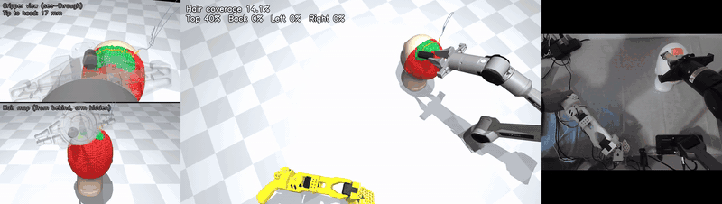
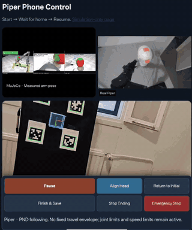

# QP_Haircut_Teleop: Quadratic Programming Based Teleoperation for Robotic Haircutting

This page summarizes QP_Haircut_Teleop, a public repository for a quadratic programming based teleoperation scheme for robotic haircutting.

- [QP_Haircut_Teleop](https://github.com/Robotic-Haircutting/QP_Haircut_Teleop): a quadratic programming based teleoperation scheme in which a follower arm tracks the operator's desired pose within its joint-angle and joint-velocity limits, without joint-to-joint correspondence between the leader and follower arms. The repository includes the paper, slides, supplementary video, and experiment code.

## Demonstrations

These demonstrations illustrate the two teleoperation applications:

- Heterogeneous leader-follower teleoperation: an SO-101 leader arm teleoperates a Piper follower arm, shown in simulation with hair coverage and in the camera view of the real arms.
- Smartphone-based teleoperation: the phone camera observes a board of four AprilTags, and the estimated phone pose serves as the desired pose of the follower, replacing the dedicated leader arm.

| Heterogeneous leader-follower teleoperation |
| --- |
|  |

| Smartphone-based teleoperation |
| --- |
|  |

Installation steps, hardware setup, and instructions for reproducing the experiments are documented in the [QP_Haircut_Teleop repository](https://github.com/Robotic-Haircutting/QP_Haircut_Teleop).
