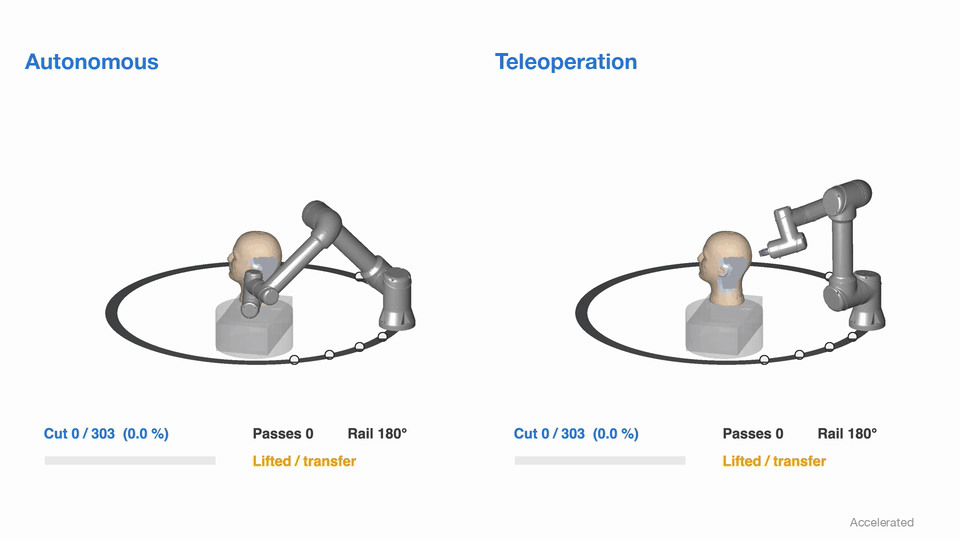
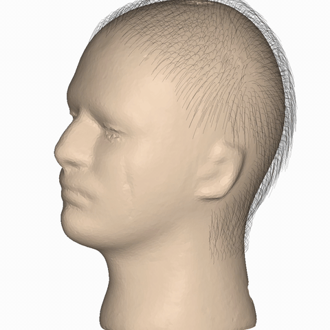
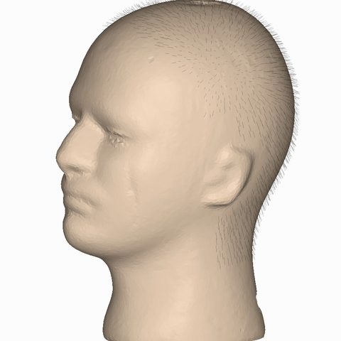

# RoboHairSim: Simulation Platform for Robotic Haircutting

This page summarizes RoboHairSim, a public simulation platform for planning and evaluating robotic haircutting.

- [RoboHairSim](https://github.com/Robotic-Haircutting/RoboHairSim): a MATLAB-based simulation platform that integrates head and hair modeling, directional clipper cutting, toolpath planning, and robot execution, and supports automated haircutting, keyboard teleoperation, and session replay.

## Demonstrations

These demonstrations illustrate the simulated haircutting workflow and its result:

- Autonomous and teleoperated haircutting: an automated run and a teleoperated run on the same scalp region, with the robot mounted on a circular floor rail.
- Before and after haircutting: the simulated hair before and after a full-head haircut with a 5 mm guard comb.

| Autonomous and teleoperated haircutting |
| --- |
|  |

| Before haircutting | After haircutting (5 mm guard) |
| --- | --- |
|  |  |

Installation steps, usage instructions, and the current model assumptions and limitations are documented in the [RoboHairSim repository](https://github.com/Robotic-Haircutting/RoboHairSim).
